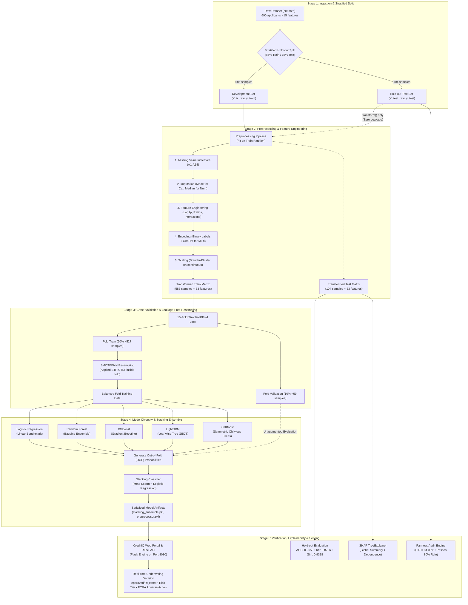
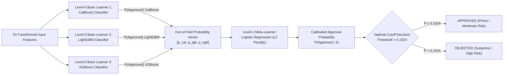

# Credit Approval ML — Methodology & Architecture

This document describes the modeling architecture, validation methodology, finance-specific evaluation metrics, and regulatory fairness framework implemented in this repository.

---

## 1. Architectural Overview

The Credit Approval system is organized into a modular, production-grade machine learning architecture designed to prevent data leakage, optimize finance-specific scorecard metrics, satisfy regulatory compliance (EEOC 80% rule), and serve real-time credit decisioning.

### 1.1 End-to-End Pipeline & System Flow

---

### 1.2 Stacking Ensemble Architecture

The production scoring engine uses a two-tier stacking architecture that combines gradient boosting models with diverse splitting schemes, blended by an L2-regularized meta-learner:

---

### 1.3 Subsystem Responsibility Matrix

| Subsystem Component | Module Location | Core Responsibility | Leakage Protection & Invariants |
| :--- | :--- | :--- | :--- |
| **Data Ingestion** | [`src/utils.py`](src/utils.py) | Ingests `crx.data`, maps column schema ($A_1$–$A_{16}$), converts targets (`+` $\rightarrow$ 1, `-` $\rightarrow$ 0). | Stratified split isolated before any transformation. |
| **Feature Transformation** | [`src/preprocessing.py`](src/preprocessing.py) | Adds missingness flags, medoid/mode imputation, log-scaling ($A_{11}$, $A_{15}$), interactions ($A_2 \times A_3$), and OHE. | Fitted strictly on development split; hold-out and test data only call `transform()`. |
| **Resampling Orchestration** | [`src/training.py`](src/training.py) | Combines SMOTE oversampling with ENN undersampling to clean noisy boundaries. | **Executed strictly within each CV fold.** Never exposed to validation folds. |
| **Model Cross-Validation** | [`src/training.py`](src/training.py) | Executes 10-fold Stratified CV, logs hyperparameter spaces and fold metrics to MLflow. | Out-of-fold predictions gathered across hold-out validation segments. |
| **Stacking Meta-Learner** | [`src/models.py`](src/models.py) | Fits Logistic Regression over base model probability vectors to reduce decision variance. | Trained exclusively on cross-validated OOF predictions. |
| **Risk & Fairness Audit** | [`src/evaluation.py`](src/evaluation.py) | Calculates finance metrics (Gini, KS, Brier, ECE), computes SHAP values, and evaluates Disparate Impact Ratio. | Evaluated on hold-out test set unseen during training. |
| **Interactive Serving** | [`app.py`](app.py) | Exposes REST API and Web UI for real-time applicant evaluation and FCRA reason code extraction. | Consumes serialized production pipeline (`preprocessor.pkl`, `stacking_ensemble.pkl`). |

---

## 2. Preventing Data Leakage

A critical failure mode in credit risk modeling is applying resampling or transformations prior to cross-validation splits:

1. **Resampling Leakage:** Applying SMOTE or SMOTEENN across the entire dataset introduces synthetic data points informed by the test/validation distribution. In this project, `SMOTEENN` is initialized and fitted **strictly inside each training fold**. The validation fold remains untouched and reflects the true production population distribution.
2. **Preprocessing Leakage:** Imputers and scalers (`SimpleImputer`, `StandardScaler`) are fit exclusively on the training partition (`X_tr_raw`) and applied via `transform()` to the hold-out set (`X_test_raw`).

---

## 3. Modeling Strategy & Ensembling

### Base Learners
- **Logistic Regression:** Serves as a transparent linear benchmark. Uses L2 regularization and scaled features.
- **Random Forest:** Non-linear bagging model with 200 estimators.
- **Gradient Boosted Trees (XGBoost, LightGBM, CatBoost):** Captures high-order feature interactions. CatBoost natively handles categorical combinations with symmetric trees, minimizing variance.

### Stacking Ensemble
- **Architecture:** Stacking classifier combining the top-3 gradient boosting architectures (`CatBoost`, `LightGBM`, `XGBoost`).
- **Meta-Learner:** L2-regularized `LogisticRegression` that maps the Out-of-Fold probability outputs of the base learners to a final calibrated risk score.
- **Benefit:** Reduces prediction variance and improves discrimination on borderline applications.

---

## 4. Banking & Credit Risk Metrics

Standard machine learning accuracy is unsuitable for credit approval due to class imbalance and asymmetric default risk. We report industry standards:

| Metric | Formula | Financial Interpretation |
|--------|---------|---------------------------|
| **AUC-ROC** | Area Under Receiver Operating Characteristic | Probability that a randomly selected approved applicant receives a higher score than a rejected applicant. Target: $\ge 0.87$. |
| **Gini Coefficient** | $\text{Gini} = 2 \times \text{AUC} - 1$ | The European banking standard for credit scorecards. Values $> 0.70$ represent investment-grade scorecard quality. Target: $\ge 0.74$. |
| **KS Statistic** | $\max_t \|F_{\text{approved}}(t) - F_{\text{rejected}}(t)\|$ | Maximum vertical separation between cumulative distribution functions. A KS $> 0.50$ is considered strong; $> 0.70$ is exceptional. Target: $\ge 0.50$. |
| **Brier Score** | $\frac{1}{N} \sum (p_i - y_i)^2$ | Strict calibration accuracy metric. $0$ is perfect; $0.25$ represents zero-skill guessing. |
| **Expected Calibration Error (ECE)** | Bin-weighted difference between predicted probability and actual frequency | Measures risk-based pricing reliability (e.g. interest rate sizing). |

---

## 5. Model Explainability (SHAP)

To satisfy consumer credit disclosure requirements (e.g., Fair Credit Reporting Act adverse action notices), model decisions must be explainable.

- **Framework:** SHAP (`TreeExplainer`) on the top-performing tree model.
- **Key Findings:**
  1. `A9` (Credit History / Prior Default flag) is the dominant driver of approval.
  2. `A11_log` (Active credit lines / Credit score proxy) provides steady monotonic approval gains.
  3. `A15_log` (Savings reserves) provides significant positive lift at higher thresholds.
  4. Missing value indicators contribute subtle negative adjustments, capturing non-random omissions.

---

## 6. Fairness & Algorithmic Bias Audit

Credit models must comply with fair lending standards (e.g., EEOC and Equal Credit Opportunity Act):

- **Protected Attribute Proxy:** Feature `A1` (Binary demographic group: `a` vs. `b`).
- **Disparate Impact Ratio (DIR):**
  $$\text{DIR} = \frac{\text{Approval Rate}(\text{Group } a)}{\text{Approval Rate}(\text{Group } b)}$$
- **Four-Fifths (80%) Rule:** If $\text{DIR} \ge 0.80$, the selection process has no adverse impact under standard regulatory scrutiny.
- **Current Audit Outcome:**
  - Group `a` Approval Rate: 37.5%
  - Group `b` Approval Rate: 44.4%
  - **DIR = 0.8438 (84.4%)** $\rightarrow$ **Passes the 80% Rule**.
