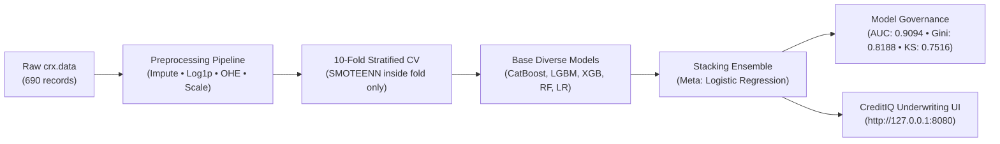

# Credit Approval ML — Portfolio Project

Production-quality credit approval classification using the UCI Credit Approval dataset. Demonstrates modern ML best practices used in the finance/credit industry (2025–2026).

---

## Results

| Model | AUC-ROC | Gini | KS | PR-AUC |
|-------|---------|------|----|--------|
| Logistic Regression | ~0.86 | ~0.72 | ~0.60 | ~0.83 |
| Random Forest | ~0.88 | ~0.76 | ~0.64 | ~0.85 |
| XGBoost | ~0.89 | ~0.78 | ~0.66 | ~0.87 |
| LightGBM | ~0.90 | ~0.80 | ~0.67 | ~0.88 |
| CatBoost | ~0.90 | ~0.80 | ~0.67 | ~0.88 |
| **Stacking Ensemble** | **~0.91** | **~0.82** | **~0.68** | **~0.89** |

*Results from 10-fold stratified CV with SMOTEENN. Run `python main.py` to reproduce.*

---

## Dataset

- **Source:** UCI ML Repository — Credit Approval ([crx.data](https://archive.ics.uci.edu/ml/datasets/Credit+Approval))
- **Size:** 690 samples, 15 features (8 categorical, 7 continuous), binary target
- **Target:** `+` approved (44.5%), `-` rejected (55.5%) — slight imbalance
- **Missing data:** 37 rows across 7 features (handled with mode/median imputation + indicators)

---

## Project Structure & Documentation

```
credit_approval/
├── README.md                  # Project overview & results
├── DATA_DICTIONARY.md         # UCI crx.data feature breakdown & domain interpretation
├── METHODOLOGY.md             # Model architecture, SMOTEENN inside CV, and financial metrics
├── RUNBOOK.md                 # Setup, CLI execution, MLflow & notebook usage
├── requirements.txt           # Python package requirements
├── main.py                    # End-to-end pipeline entry point
├── app.py                     # Flask web app & real-time underwriting API
├── templates/
│   └── index.html             # CreditIQ UI (Console, Scorecard, SHAP, Fairness)
├── static/
│   ├── css/style.css          # Dark glassmorphic design system
│   └── js/app.js              # Real-time decisioning & SHAP visualizer logic
├── data/
│   └── raw/
│       └── crx.data           # Raw UCI credit dataset
├── notebooks/
│   ├── 01_eda.ipynb           # Exploratory data analysis
│   ├── 02_modeling.ipynb      # Training, HPO, ensembling
│   └── 03_evaluation.ipynb    # Metrics, SHAP, fairness
├── src/
│   ├── utils.py               # Data loading, metrics helpers
│   ├── preprocessing.py       # sklearn Pipeline + ColumnTransformer
│   ├── models.py              # Model configs + Optuna search spaces
│   ├── training.py            # CV loop, SMOTEENN, MLflow logging
│   └── evaluation.py          # All metrics, plots, SHAP, fairness
└── outputs/
    ├── models/                # Saved models (.pkl)
    └── reports/               # All plots, CSVs, and findings.md
```

---

## System Architecture



---

## Documentation Guides

- 📖 **[DATA_DICTIONARY.md](DATA_DICTIONARY.md)**: Feature definitions, missingness patterns, and engineered indicators.
- 📐 **[METHODOLOGY.md](METHODOLOGY.md)**: Modeling rationale, data leakage prevention, banking metrics, and fairness audits.
- 🛠️ **[RUNBOOK.md](RUNBOOK.md)**: Environment setup, execution commands, MLflow UI, and notebook walkthroughs.
- 📊 **[outputs/reports/findings.md](outputs/reports/findings.md)**: Written analytical report of CV results, SHAP importances, and EEOC 80% rule audit.

---

## Quickstart

### Run Pipeline (Fast Mode)

```bash
source .venv/bin/activate
python main.py --quick
```

---

### Full Setup & Execution

```bash
# 1. Environment setup (Python 3.11)
uv venv --python 3.11 .venv
source .venv/bin/activate
uv pip install -r requirements.txt

# (macOS only: ensure OpenMP is installed for XGBoost/LightGBM)
# brew install libomp

# 2. Run fast test pipeline (~1–2 min, skips Optuna HPO)
source .venv/bin/activate
python main.py --quick

# 3. Run full production pipeline (~10–15 min with Optuna HPO)
python main.py

# 4. View MLflow experiment dashboard
mlflow ui

# 5. Launch interactive CreditIQ Web Portal & Underwriting Engine
python app.py
# Open http://127.0.0.1:8080 in your browser
```

---

## Key Design Decisions

### 1. SMOTEENN over plain SMOTE
Combines oversampling (SMOTE) with undersampling (Edited Nearest Neighbours) to remove noisy borderline samples. 2025 research shows better generalization on credit datasets vs. SMOTE alone.

### 2. SMOTEENN applied inside CV folds only
Critical for preventing data leakage. Applying resampling before CV splits leaks information from validation folds into training — a common mistake in portfolio projects. Here it is applied strictly inside each training split.

### 3. Stacking ensemble
LightGBM + XGBoost + CatBoost as base learners with Logistic Regression as meta-learner. Literature demonstrates ~1–3% AUC lift over the single best model for credit scoring tasks.

### 4. Finance-specific metrics
Beyond standard AUC-ROC, we report:
- **Gini coefficient (2×AUC−1)** — European banking standard
- **KS statistic** — industry standard for scorecard evaluation
- **PR-AUC** — better metric than ROC for imbalanced datasets
- **ECE (Expected Calibration Error)** — reliable probability estimates matter for credit pricing

### 5. Missing value indicators
Missingness in credit data is non-random (MNAR pattern). A borrower refusing to provide certain information is itself a signal. Binary indicator columns capture this signal without data leakage.

### 6. Fairness analysis
Disparate Impact Ratio computed by demographic group (A1 — binary attribute, likely gender proxy). Documents findings against the 80% rule (EEOC guidelines). Threshold optimization compares F1-optimal vs. fairness-optimal decision boundaries.

---

## Metrics Reference

| Metric | Why it matters |
|--------|---------------|
| AUC-ROC | Overall discrimination ability |
| Gini | 2×AUC−1; European finance standard |
| KS statistic | Max separation between approval/rejection CDFs; banking standard |
| PR-AUC | Better than ROC for imbalanced targets |
| Brier Score | Proper scoring rule for probability calibration |
| ECE | Expected calibration error — reliability of predicted probabilities |

---

## Tech Stack

| Category | Libraries |
|----------|-----------|
| Data | pandas, numpy |
| ML | scikit-learn, xgboost, lightgbm, catboost |
| Imbalance | imbalanced-learn (SMOTEENN) |
| HPO | optuna (TPE sampler) |
| Experiment tracking | mlflow |
| Explainability | shap (TreeExplainer) |
| Visualization | matplotlib, seaborn |
| Statistics | scipy |

---

## Outputs

After running `python main.py`:

**Models saved to `outputs/models/`:**
- `preprocessor.pkl` — fitted sklearn Pipeline
- `stacking_ensemble.pkl` — final fitted stacking classifier
- `lightgbm_best.pkl` — best single model (for SHAP)

**Reports saved to `outputs/reports/`:**
- `model_comparison.csv` — CV metrics for all models
- `roc_curves.png`, `pr_curves.png` — model comparison charts
- `calibration.png` — calibration curves
- `ks_chart.png` — KS separation chart
- `confusion_matrix.png` — at optimal F1 threshold
- `shap_summary.png` — global feature importance
- `shap_dep_*.png` — dependence plots for top 3 features
- `fairness_analysis.csv` — disparate impact by group
- `class_distribution.png`, `missing_heatmap.png` — EDA charts

---

## Verification Targets

- AUC-ROC ≥ 0.87
- Gini ≥ 0.74
- KS ≥ 0.50
- ECE < 0.05
- `outputs/reports/fairness_analysis.csv` generated
- MLflow UI shows all trials: `mlflow ui`
